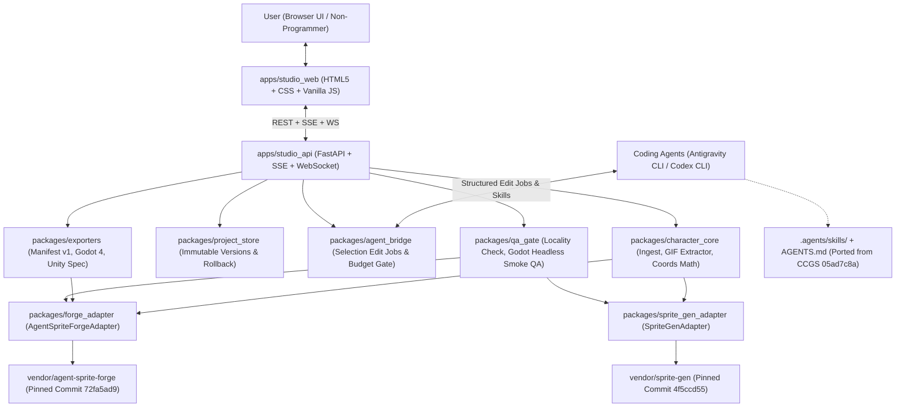

# Character Forge Studio — Architecture & Technical Specifications (`ARCHITECTURE.md`)

---

## 1. System Overview

**Character Forge Studio** is a Python-first, modular 2D/Pixel Art character production monorepo designed for non-programmers and operated collaboratively with **Google Antigravity CLI** and **OpenAI Codex CLI**.

It runs locally via a Windows CMD-friendly launcher (`run-studio.bat`) and provides a zero-build HTML5/CSS/Vanilla-JS visual studio backed by FastAPI, combining:
1. **`agent-sprite-forge`** (`vendor/agent-sprite-forge`) — Primary animation production, RGBA canonicalization, cutout rigging, edit locality QA, and Godot 4 / Aseprite export engine.
2. **`sprite-gen`** (`vendor/sprite-gen`) — Selected frame extraction, non-destructive curation sidecar patterns, procedural secondary motion (`breathe`, `sway`, `shadow`, `recolor`), and motion scoring.
3. **`Claude-Code-Game-Studios`** (`vendor/Claude-Code-Game-Studios`) — Reference architecture for agent orchestration, asset specifications, and evidence-based QA gates (`COMPLIANT` / `NOT ASSESSED` / `BLOCKED` / `NON-COMPLIANT`), ported to `.agents/skills/` and `AGENTS.md`.



---

## 2. Monorepo Directory Layout

```text
Character-Forge-Studio/
├── AGENTS.md                        # Shared instructions for Google Antigravity CLI & OpenAI Codex CLI
├── THIRD_PARTY_NOTICES.md           # Full upstream licenses & Apache-2.0 NOTICE attribution
├── pyproject.toml                   # Python monorepo packaging & pytest configuration
├── requirements.txt                 # Pinned runtime & test dependencies
├── run-studio.bat                   # Windows CMD-friendly one-click studio launcher
├── run-studio.sh                    # POSIX helper launcher for Linux/CI verification
├── .agents/
│   └── skills/                      # Shared Agent Skills standard (Antigravity + Codex compatible)
│       ├── character-asset-spec/SKILL.md
│       ├── pixel-region-edit/SKILL.md
│       └── godot-unity-export-qa/SKILL.md
├── apps/
│   ├── studio_api/                  # FastAPI localhost backend (REST + SSE + WebSocket)
│   │   ├── __init__.py
│   │   ├── main.py
│   │   └── streaming.py
│   └── studio_web/                  # Zero-build frontend (HTML5 Canvas, CSS, Vanilla JS)
│       └── static/
│           ├── index.html
│           ├── styles.css
│           └── app.js
├── packages/
│   ├── character_core/              # Asset ingest, GIF frame extraction, zoom-invariant pixel math
│   ├── project_store/               # Project save/load, immutable version snapshots, rollback
│   ├── forge_adapter/               # Clean boundary adapter over vendor/agent-sprite-forge
│   ├── sprite_gen_adapter/          # Clean boundary adapter over vendor/sprite-gen
│   ├── agent_bridge/                # Selection edit JSON jobs, region-only pixel apply, budget gate
│   ├── exporters/                   # Engine-independent manifest v1 & Godot 4 export prototype
│   └── qa_gate/                     # Edit locality check, Godot 4 headless smoke test, QA reports
├── scripts/
│   └── prepare_github_forks.py      # Non-destructive GitHub fork preparation & scope verifier
├── docs/
│   ├── audit/UPSTREAM_AUDIT.md
│   ├── architecture/ARCHITECTURE.md
│   ├── architecture/INTEGRATION_MATRIX.md
│   ├── architecture/PHASE2_TECHNICAL_SPECS.md
│   └── roadmap/IMPLEMENTATION_PLAN.md
├── tests/                           # Automated pytest suite (unit, integration, e2e, Godot smoke)
└── vendor/                          # Read-only pinned upstream repositories (never modified)
    ├── VENDOR_LOCK.json
    ├── agent-sprite-forge/
    ├── sprite-gen/
    └── Claude-Code-Game-Studios/
```

---

## 3. Core Architectural Invariants (Phase 1 MVP)

### 3.1 Non-Destructive Source Asset Preservation
When a user uploads a PNG or GIF:
1. The raw uploaded bytes are written once to `workspace/projects/<project_id>/original/<original_filename>` with write-once semantics.
2. Its SHA-256 digest (`original_sha256`) and byte size are recorded in `project.json`.
3. Every subsequent operation (frame extraction, region selection edit, palette operation, rollback, or engine export) reads from `versions/vXXXX/frames/` and writes to a **new** immutable version directory `versions/vYYYY/frames/`.
4. Before and after every edit or rollback operation, `verify_original_unchanged()` recomputes the SHA-256 of `original/<original_filename>` and asserts exact byte identity against `original_sha256`.

### 3.2 Zoom-Invariant Canvas-to-Source Pixel Coordinate Mapping
The studio viewport renders a frame of dimensions $(W_{\text{src}}, H_{\text{src}})$ onto an HTML5 canvas using an origin offset $(\text{pan}_x, \text{pan}_y)$ and zoom scale $z > 0$ (with `imageSmoothingEnabled = false` for crisp pixel art inspection).

Given a client pointer event at $(x_{\text{client}}, y_{\text{client}})$ relative to the canvas bounding client rect $(L, T, W_{\text{css}}, H_{\text{css}})$ and internal canvas buffer $(W_{\text{buf}}, H_{\text{buf}})$:

$$x_{\text{canvas}} = (x_{\text{client}} - L) \cdot \frac{W_{\text{buf}}}{W_{\text{css}}}, \quad y_{\text{canvas}} = (y_{\text{client}} - T) \cdot \frac{H_{\text{buf}}}{H_{\text{css}}}$$

$$x_{\text{src}} = \left\lfloor \frac{x_{\text{canvas}} - \text{pan}_x}{z} \right\rfloor, \quad y_{\text{src}} = \left\lfloor \frac{y_{\text{canvas}} - \text{pan}_y}{z} \right\rfloor$$

For any rectangular drag selection between canvas points $(x_1, y_1)$ and $(x_2, y_2)$, the clamped source-image pixel bounding box $(x, y, w, h)$ in integer pixel coordinates $[0, W_{\text{src}})$ and $[0, H_{\text{src}})$ is:

$$x_0 = \text{clamp}\left(\left\lfloor \frac{\min(x_1, x_2) - \text{pan}_x}{z} \right\rfloor, 0, W_{\text{src}} - 1\right)$$

$$y_0 = \text{clamp}\left(\left\lfloor \frac{\min(y_1, y_2) - \text{pan}_y}{z} \right\rfloor, 0, H_{\text{src}} - 1\right)$$

$$x_1' = \text{clamp}\left(\left\lfloor \frac{\max(x_1, x_2) - \text{pan}_x}{z} \right\rfloor + 1, x_0 + 1, W_{\text{src}}\right)$$

$$y_1' = \text{clamp}\left(\left\lfloor \frac{\max(y_1, y_2) - \text{pan}_y}{z} \right\rfloor + 1, y_0 + 1, H_{\text{src}}\right)$$

$$w = x_1' - x_0, \quad h = y_1' - y_0$$

This exact formula is implemented identically in `packages/character_core/coords.py` and `apps/studio_web/static/app.js`, and verified across arbitrary zoom factors ($0.5\times, 1\times, 2\times, 4\times, 8\times, 16\times, 32\times$) and pan offsets.

### 3.3 Structured Selection Edit Job & Version History Model
- **Edit Job (`character-forge.edit_job.v1`)**:
  - Stores `job_id`, `project_id`, `base_version_id`, `frame_index`, `selection_box` (`{x, y, w, h}` in source pixels), `normalized_uv_box` (`[u0, v0, u1, v1]`), `instruction` (natural-language prompt), `operation` (optional deterministic local pixel operation or agent handoff), `status` (`queued` -> `running` -> `completed` / `awaiting_agent` / `failed`), `events` log, and `locality_qa` report.
- **Version History & Rollback**:
  - Every project maintains an ordered list of immutable version snapshots (`v0001` initial import, `v0002` edit/operation, `v0003` rollback or subsequent edit).
  - Rolling back to `vXXXX` creates a new head pointer (and records a rollback event in the audit log) while preserving all prior versions and the untouched original asset.

### 3.4 Real-Time Job Streaming (SSE & WebSocket)
- `GET /api/projects/{project_id}/events` (Server-Sent Events) and `WS /ws/projects/{project_id}` stream real-time events emitted by `EventHub` whenever a job starts, completes a step, produces a locality check, creates a new version, rolls back, or finishes an engine export. No fake timers or simulated AI progress bars are used.

### 3.5 Engine-Independent Character Manifest & Godot 4 Export Prototype
- **Character Manifest (`character-forge.manifest.v1`)**:
  - Records character metadata, original file provenance (`original_filename`, `original_sha256`), active version (`version_id`), canvas dimensions `(width, height)`, subject anchor `(anchor_x, anchor_y)` computed via `agent-sprite-forge`'s `forge_core`, frame list (`index`, `duration_ms`, `sha256`, `relative_path`, `bbox`), and animation clips (`name`, `loop`, `fps`, `frames`).
- **Godot 4 Export (`packages/exporters/godot4.py`)**:
  - Converts the active project version into `agent-sprite-forge`'s `generate2dsprite.animation_clips.v2` format and invokes `vendor/agent-sprite-forge/skills/generate2dsprite/scripts/export_engine.py --target godot-spriteframes`.
  - Produces a complete, self-contained Godot 4 bundle:
    - `<name>.tres` (`SpriteFrames` resource with `AtlasTexture` sub-resources and exact relative frame durations)
    - `<name>.tscn` (`AnimatedSprite2D` scene with `nearest` pixel-art filter and anchor offset)
    - `<name>-atlas-00.png` (lossless RGBA sprite sheet)
    - `project.godot` (Godot 4.3 project file enabling immediate `godot --headless --path <export_dir> --import --quit` verification)

---

## 4. Phase 2 — Technical Specifications (Design Only, Not Implemented Before Phase 1 Acceptance)

> **Important Rule**: Per project instructions, Phase 2 capabilities are **designed and specified only** in this phase. Full technical specifications, JSON schemas, data structures, and adapter contracts for all 10 Phase 2 modules are documented in [`docs/architecture/PHASE2_TECHNICAL_SPECS.md`](PHASE2_TECHNICAL_SPECS.md) and summarized below.

| # | Phase 2 Capability | Summary of Technical Design (Full Spec in `PHASE2_TECHNICAL_SPECS.md`) |
|---|---|---|
| 1 | **AI Image-to-Animation Integration** | Budget-gated pipeline combining `agent-sprite-forge` (`prepare_i2v_input.py` -> `gait_loop.py` -> `register_clip.py` -> `colour_lock.py` -> `finish_frames.py`) with `sprite-gen` loop restoration (`video/restoration.py`) and explicit `BudgetGate` token/USD ceiling approval. |
| 2 | **4/8 Directional Character Generation** | Compass turn-sheet specification (`S, SW, W, NW, N, NE, E, SE`) anchored to a master still (`master_still.py` + `video_set_sheet.py`), enforcing cross-direction silhouette height parity ($\pm 1\text{ px}$), shared ground baseline, and asymmetric prop handedness verification (`handed.py`). |
| 3 | **Humanoid, Quadruped & Winged Anatomy Profiles** | Declarative JSON schema (`character-forge.anatomy_profile.v1`) defining bone topology, IK chains, ground contact feet/paws, phase offsets, and wing beat envelopes for `humanoid_biped`, `quadruped_digitigrade`, and `winged_biped_or_avian`. |
| 4 | **Cutout Rigging & Pixel-Safe Sprite Swapping** | Adapter over `agent-sprite-forge`'s `codeart2d/scripts/rig_animate.py` (`rig.v1` SVG + `codeart2d.rig_anim.v1`), supporting slot variants (`data-variant`), Z-order sorting (`data-z`), 2-bone ground-clamped IK, and Route D pixel-clean rasterization (0 partial alpha, 0 off-palette pixels, 1px outline post-pass). |
| 5 | **Bone, Pivot, Mesh & Animation Keyframe Editors** | Viewport gizmo layer over the studio HTML5 canvas for interactive pivot placement, hierarchical bone transforms $M_{\text{world}} = M_{\text{parent}} \cdot T(d) \cdot T(p) \cdot R(\theta) \cdot S(s) \cdot T(-p)$, 2D deforming quad/triangle meshes, and normalized $t \in [0, 1)$ keyframe dopesheet curves. |
| 6 | **Separate VFX Timelines & Attachment Anchors** | Decoupled VFX track schema (`character-forge.vfx_timeline.v1`) binding named socket anchors (`hand_r`, `weapon_tip`, `cast_origin`, `feet_dust`) per frame with independent tick rates, blend modes, and foreground/background Z-layers. |
| 7 | **Visual Selection to Agent Edit-Command Protocol** | Bidirectional protocol (`character-forge.agent_edit_protocol.v2`) translating rectangular/lasso/magic-wand pixel masks + frame ranges + natural-language instructions into deterministic CLI/MCP tasks for Google Antigravity CLI and OpenAI Codex CLI. |
| 8 | **Strict Pixel-Preservation Editing** | Bitwise binary edit mask $M(x, y) \in \{0, 1\}$ enforcement: $\forall (x, y) \notin M_{\text{allowed}}, P_{\text{after}}(x, y) \equiv P_{\text{before}}(x, y)$ (exact 32-bit RGBA equality, $\text{MAE}_{\text{outside}} = 0.0$), verified automatically before committing a version snapshot. |
| 9 | **Unity Import/Export Adapter** | Deterministic exporter (`packages/exporters/unity_adapter.py`) consuming `agent-sprite-forge` Aseprite JSON + atlas PNG and emitting Unity `.png.meta` (`TextureImporter` with `spriteMode: 2`, `filterMode: 0` Point, `textureCompression: 0` Uncompressed, custom pivot alignment), `.anim` clips, and `.controller` state machines. |
| 10 | **Automated & Visual Animation QA** | Unified multi-gate QA harness combining `agent-sprite-forge` (`validate_animation.py`, `sheet_qc.py`, `edit_locality_check.py`), `sprite-gen` (`inspect.py`, `score.py`, `motion.py`, `handed.py`), and `Claude-Code-Game-Studios` evidence-based verdict reporting (`COMPLIANT`, `WARNINGS`, `NOT ASSESSED`, `NON-COMPLIANT`). |
